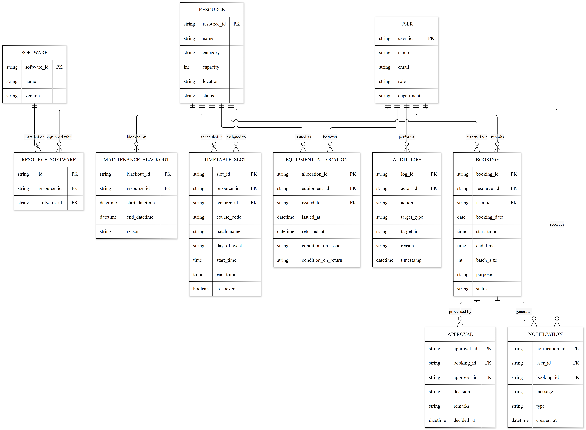
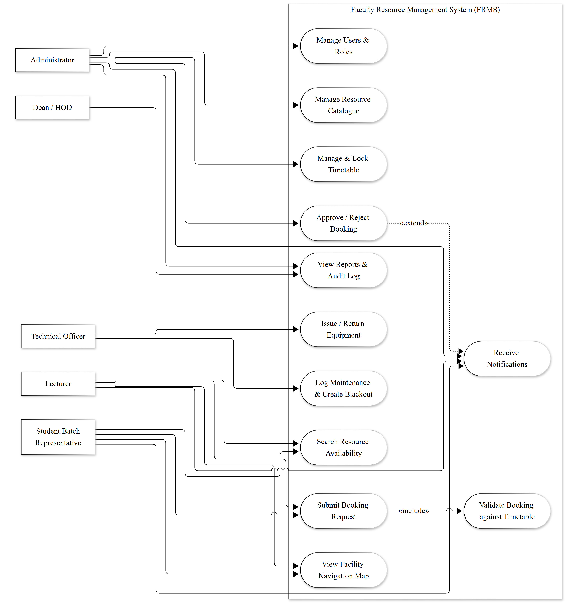
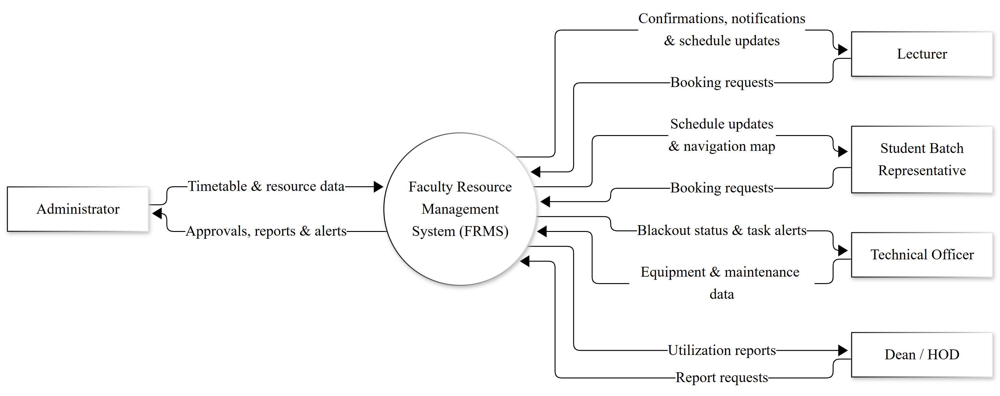
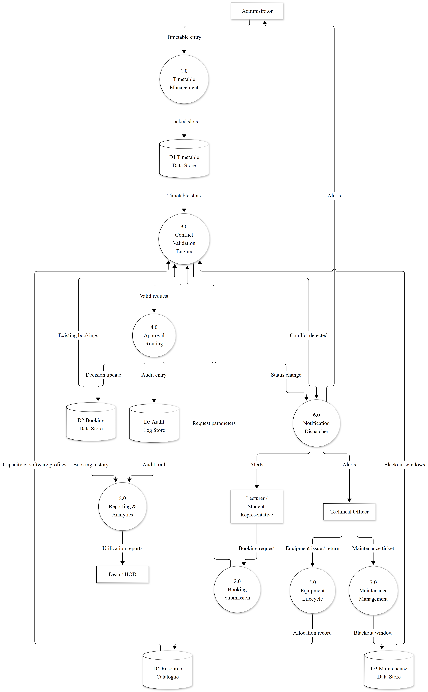

# CAPSTONE PROJECT PROPOSAL

### Faculty Resource Management System (FRMS)

**A Timetable-Authoritative Resource Allocation and Booking Platform for the Faculty of Computing**

 

**Group:** [Group Number]

**Department of Computing and Information Systems**

**Faculty of Computing**

**Sabaragamuwa University of Sri Lanka**

 

**October 2026**

---

## Approval of Capstone Project

**1. Title of the Capstone Project:**

Faculty Resource Management System (FRMS) — A Timetable-Authoritative Resource Allocation and Booking Platform for the Faculty of Computing

**2. Details of Group Members:**

| Index No | Name with Initials | Email | Mobile No | Signature of Student |
|----------|--------------------|-------|-----------|----------------------|
| [Index 1] | [Name 1] | [Email 1] | [Mobile 1] | |
| [Index 2] | [Name 2] | [Email 2] | [Mobile 2] | |
| [Index 3] | [Name 3] | [Email 3] | [Mobile 3] | |
| [Index 4] | [Name 4] | [Email 4] | [Mobile 4] | |
| [Index 5] | [Name 5] | [Email 5] | [Mobile 5] | |

**3. Name of the Mentor:** [Mentor Name]

**4. Mentor's Designation:** [Mentor Designation]

**5. Mentor's Organization:** [Mentor Organization]

**6. Name of the Internal Supervisor:** [Internal Supervisor Name]

**7. Internal Supervisor's Designation:** [Internal Supervisor Designation]

 

**For office use only:**

Approved / Not approved: ………………………………

Signature of the Mentor: ………………………………  Signature of the Supervisor: ………………………………

Date: ………………………………

Suggestions if any:

………………………………………………………………………………………………………………………………………

………………………………………………………………………………………………………………………………………

---

## Index

| Section | Page |
|---------|------|
| Approval of Capstone Project | 1 |
| 1. Acknowledgement | 3 |
| 2. Group Details and Contribution | 4 |
| 3. Introduction and Objectives | 5 |
| 3.1 Background and Context | 5 |
| 3.2 Core Problems | 5 |
| 3.3 Core Problem Statement | 6 |
| 3.4 Current Process of Booking Lecture Halls and Labs | 6 |
| 3.5 Issues in the Current Process | 7 |
| 3.6 Proposed Solutions | 8 |
| 3.7 Build versus Buy Justification | 9 |
| 3.8 Objectives of the Project | 10 |
| 3.9 Scope of the Project | 11 |
| 4. Analysis | 12 |
| 4.1 Feasibility Study | 12 |
| 4.2 Entity-Relationship (ER) Diagram | 14 |
| 4.3 Use Case Diagram | 15 |
| 4.4 Data Flow Diagram (DFD) | 16 |
| 5. Hardware and Software Requirements | 18 |
| 5.1 Hardware Requirements | 18 |
| 5.2 Software Requirements | 19 |
| 6. Tables and Structure, Number of Modules, Details of Modules, Data Structure | 21 |
| 6.1 System Overview | 21 |
| 6.2 Overview of Modules | 21 |
| 6.3 Details of Modules | 22 |
| 6.4 Database Tables and Structure | 26 |
| 7. Proposed System | 29 |
| 7.1 Functional Requirements | 29 |
| 7.2 Non-Functional Requirements | 31 |
| 7.3 Methodology | 32 |
| 8. Modules Split-up and Gantt Chart References | 34 |
| 8.1 Module Split-up | 34 |
| 8.2 Gantt Chart Representation | 35 |
| 9. Cost Analysis | 37 |

---

## 1. Acknowledgement

We would like to express our sincere gratitude to [Dean Name], Dean of the Faculty of Computing, [Head of Department Name], Head of the Department of Computing and Information Systems, and [Capstone Project Coordinator Name], Capstone Project Coordinator of the Department of Computing and Information Systems, Sabaragamuwa University of Sri Lanka, for their invaluable guidance, encouragement, and continuous support throughout the course of our studies. Their leadership and dedication have created an inspiring academic environment that greatly contributed to the initiation of this Capstone Project.

We also extend our heartfelt thanks to our internal supervisor, [Internal Supervisor Name], and our industry mentor, [Mentor Name], for their continuous guidance, constructive feedback, and technical expertise. Their insightful advice and constant encouragement have been instrumental in shaping the direction and the scope of this project.

Additionally, we would like to convey our sincere appreciation to the administrative and technical staff of the Faculty of Computing, whose insights into the current resource allocation workflows and operational constraints provided the empirical foundation for this proposal. Finally, we extend our gratitude to all the academic staff, colleagues, and well-wishers who contributed, directly or indirectly, to the successful completion of this work.

---

## 2. Group Details and Contribution

The project has been designed as a set of cohesive, loosely coupled modules, and responsibilities have been distributed according to each member's technical strengths. The contribution matrix below aligns every member with the specific modules and cross-cutting activities for which they are primarily accountable. All members participate collectively in requirements analysis, integration testing, documentation, and the final demonstration.

| Index No | Name with Initials | Email | Mobile No | Assigned Module(s) / Role | Core Contribution |
|----------|--------------------|-------|-----------|---------------------------|-------------------|
| [Index 1] | [Name 1] | [Email 1] | [Mobile 1] | Module 3 & 4 — Timetable Authority & Conflict Engine | Backend architecture (Node.js/Express), Prisma schema and MySQL relational design, timetable-locking logic, and the multi-variable conflict-detection engine. |
| [Index 2] | [Name 2] | [Email 2] | [Mobile 2] | Module 5 & 6 — Booking & Approval Routing | Next.js booking interface, availability calendar, request lifecycle, and the resource-specific approval routing workflows. |
| [Index 3] | [Name 3] | [Email 3] | [Mobile 3] | Module 1 & 2 — User Management & Resource Catalogue | Firebase Authentication and RBAC integration, resource catalogue management, and capacity/software-profile metadata. |
| [Index 4] | [Name 4] | [Email 4] | [Mobile 4] | Module 7 & 8 — Equipment Lifecycle & Maintenance | Equipment checkout/check-in tracking, condition logging, maintenance ticketing, and maintenance blackout enforcement. |
| [Index 5] | [Name 5] | [Email 5] | [Mobile 5] | Module 9, 10 & 11 — Map, Notifications & Reporting | Interactive facility navigation map, notification and alert service, audit logging, analytics dashboards, deployment (Vercel/Render), and compliance documentation. |

> **Scope-control note:** Backend effort is concentrated around Modules 3 and 4, which constitute the intellectual core of the system. To manage this concentration risk, the team has deliberately adopted a reduced-but-complete feature set (see Section 3.9), avoided real-time streaming technologies, and adopted a disciplined Agile delivery model. This is a deliberate feasibility decision rather than a limitation of ambition.

---

## 3. Introduction and Objectives

### 3.1 Background and Context

In a modern university environment, the efficient management of physical infrastructure — lecture halls, computer laboratories, conference and meeting rooms, multimedia equipment, and faculty vehicles — is fundamental to sustaining academic excellence and administrative fluidness. As the Faculty of Computing (FOC) continues to grow in student intake, degree programmes, and industrial engagement, the demand for a small and fixed pool of shared physical resources has begun to exceed its availability.

At present, the Faculty operates under a largely manual, document-centric, and spreadsheet-based allocation process. A lecturer who requires a lecture hall, laboratory, or piece of equipment must initiate a request through informal channels and await an administrative decision that is made without a formal, machine-enforced set of allocation rules. The consequences of this workflow — frequent timetable clashes, uncoordinated double-bookings, last-minute cancellations, and capacity mismatches — are experienced daily by academic staff, students, and administrators alike.

The Faculty Resource Management System (FRMS) is proposed as a centralized, web-based digital transformation of this workflow, purpose-built for the Faculty of Computing. Unlike generic university-wide booking platforms that treat every reservation as an undifferentiated request, the FRMS treats the official academic timetable as the **authoritative baseline** of resource availability. Every ad-hoc request — a makeup lecture, a practical session, a meeting, or a vehicle trip — is automatically validated against this baseline, existing approved bookings, and maintenance blackout windows before it can be confirmed. In doing so, the FRMS structurally prevents the scheduling failures that currently disrupt the Faculty's academic calendar.

### 3.2 Core Problems

The Faculty currently faces four interrelated and escalating operational problems:

1. **Resource Scarcity** — The Faculty maintains a limited pool of shared physical assets, including lecture halls, specialized computer laboratories, multimedia equipment, vehicles, and conference halls. These resources must simultaneously serve several departments, degree programmes, and student batches.

2. **Academic Disruption** — Because these scarce resources are managed without a central coordinating system, academic staff and students experience frequent lecture rescheduling, unplanned lecture cancellations, and timetable clashes between different batches.

3. **Academic Calendar Slippage** — The resulting disruption makes it extremely difficult for academic staff to cover the prescribed syllabus, conduct practical sessions as scheduled, and adhere to the officially approved academic calendar of the Faculty.

4. **Administrative Overhead** — When meetings must be arranged between departments, faculty boards, academic staff, and non-academic staff, an excessive amount of time is consumed manually coordinating availability and booking conference and meeting rooms.

### 3.3 Core Problem Statement

The Faculty currently relies on a manual and inefficient process to manage limited physical resources, including lecture halls, labs, equipment, and conference rooms. This poor coordination causes frequent timetable clashes between student batches, uncoordinated double-bookings, and last-minute lecture cancellations.

Consequently, academic staff face severe difficulties in completing syllabi and practical sessions on time, forcing deviations from the official academic calendar. Additionally, staff lose significant time manually scheduling meeting spaces. A centralized, timetable-aware system is urgently needed to prevent these scheduling conflicts and streamline resource allocation.

### 3.4 Current Process of Booking Lecture Halls and Labs

The following steps describe the existing, predominantly manual workflow through which teaching and meeting spaces are currently allocated:

1. Lecturers contact the faculty administration via email or telephone to request and reserve lecture halls, computer labs, or other facilities.
2. The administrator manually evaluates the competing requests, decides the priority level, and assigns an available lecture hall or laboratory to each requester.
3. Upon receiving administrative confirmation, the lecturer informs the respective batch representatives of the allocated time and location.
4. Batch representatives post a message in the student WhatsApp group so that every member of the batch can view the update.
5. When a board, department, or staff meeting is convened, all participants are informed manually by the administrator, coordinator, or the person convening the meeting.
6. All central booking records are maintained in a shared spreadsheet so that academic staff can view current allocations.

### 3.5 Issues in the Current Process

The manual and spreadsheet-based workflow above suffers from the following systemic weaknesses:

1. **Priority Ambiguity** — In scenarios where multiple staff members compete for the same resource at the same time, the administrator has no objective, rule-based method of determining who should receive priority, leading to inconsistent and contested decisions.

2. **Human Error in Advance Booking** — Lecturers occasionally forget to reserve a lecture hall in advance, resulting in last-minute timetable clashes and ad-hoc firefighting on the day of the lecture.

3. **Delayed Notifications** — Students are frequently informed about lectures at extremely short notice — sometimes even at midnight — which disrupts their academic preparation and daily planning.

4. **Ghost Bookings** — When a lecturer cancels a lecture at the last minute, the hall is not marked as vacant in the spreadsheet, preventing any other staff member from utilising the now-empty space.

5. **Short-Notice Meetings** — When staff are summoned to meetings via email and telephone calls at short notice, they may have prior commitments or insufficient time to prepare, reducing meeting effectiveness.

6. **Capacity Mismatches** — Lecture attendance fluctuates according to the department, batch, and subject. The manual system cannot enforce capacity rules, causing small batches to occupy large auditoriums while large batches are assigned to undersized rooms.

7. **Spreadsheet Inadequacy** — A flat spreadsheet lacks concurrency control and automated business-rule enforcement, making it fundamentally insufficient for a large-scale institutional booking system.

8. **Equipment Borrowing Inefficiencies** — Portable equipment such as projectors, laptops, and HDMI cables lacks a clear checkout and check-in log, making it difficult to trace accountability for misplaced or damaged items.

9. **Conference Hall Booking Delays** — Coordinating meeting times through manual availability checks leads to severe administrative delays, and conference rooms are frequently double-booked or occupied by groups without prior notice.

10. **Vehicle Booking Miscommunication** — Faculty vehicle reservations are managed separately from the academic schedule, leading to miscommunications between drivers, administrators, and lecturers regarding trip schedules and vehicle availability.

11. **Lab Allocation and Software Blindspots** — Computer labs require specific software configurations for different practical sessions. The manual system cannot easily track which lab has the required software, occasionally resulting in students being assigned to labs that are unequipped for their coursework.

### 3.6 Proposed Solutions

To resolve the inefficiencies of the manual scheduling workflow, the FRMS proposes the following integrated solutions:

1. **Timetable-Centric Conflict Engine** — Implement a centralized digital system in which the official academic timetable forms a locked baseline. Every ad-hoc booking request is automatically cross-checked against this timetable, existing bookings, and maintenance blackouts, thereby structurally preventing double-bookings.

2. **Automated Capacity and Requirement Matching** — Enforce rule-based validation that automatically checks a requested batch size against the physical seating capacity of the room, and matches laboratory software requirements to the correct computer lab before allowing a booking to proceed.

3. **Digital Asset Lifecycle Tracking** — Introduce an equipment checkout module to log the real-time status, borrower identity, and physical condition of portable assets (projectors, laptops, and similar equipment) upon issue and return, ensuring strict accountability.

4. **Unified Scheduling for Vehicles and Conference Rooms** — Centralize faculty vehicle and meeting room reservations within the main platform, streamlining administrative approvals, driver coordination, and participant notifications.

5. **Interactive Facility Navigation Map** — Integrate a digital faculty map within the student and staff dashboards so that new students, visiting lecturers, and meeting attendees can easily locate specific lecture halls, computer labs, and conference rooms without confusion.

6. **Automated Real-Time Notifications** — Replace manual WhatsApp messages and phone calls with automated dashboard alerts and email notifications, ensuring that students and staff are instantly informed of room confirmations, cancellations, or schedule changes.

### 3.7 Build versus Buy Justification

A natural question that arises is why an off-the-shelf software product or an existing university-wide system could not simply be purchased or reused instead of building a bespoke solution. The Faculty of Computing operates with a very specific internal architecture and operational flow. Acquiring a pre-made, off-the-shelf software product is not viable because generic university management systems are far too broad and lack the granularity required for our specific requirements. Since university-wide systems are out of scope and do not properly handle our specialised inter-faculty communications, custom equipment tracking, and strict timetable-centric operations, a custom-built, faculty-specific solution is strictly required.

Moreover, a purchased platform would impose its own rigid data model, approval hierarchy, and terminology onto the Faculty's existing academic processes, necessitating disruptive operational change rather than adaptation to the institution. A purpose-built system, by contrast, can encode the Faculty's actual business rules — timetable authority, capacity enforcement, laboratory software matching, differentiated approval routing, and equipment accountability — as first-class system behaviour. The FRMS is therefore justified as a targeted, maintainable, and pedagogically appropriate custom solution whose scope and cost remain fully within the reach of a 15-week undergraduate Capstone Project.

### 3.8 Objectives of the Project

The primary objective of the FRMS is to design, develop, and deploy an intelligent, timetable-aware web platform that streamlines the allocation, booking, and monitoring of Faculty of Computing resources while eliminating manual scheduling errors.

The specific objectives of the project are:

- **Establish Timetable Authority** — To implement a locked, authoritative academic timetable against which every ad-hoc booking request is automatically validated.
- **Automate Multi-Variable Conflict Detection** — To prevent double-bookings by simultaneously checking resource availability, lecturer scheduling conflicts, and maintenance blackout windows at the point of request.
- **Enforce Rule-Based Capacity and Requirement Matching** — To automatically block or flag requests in which the intended batch size exceeds the physical capacity of the requested facility, and to match laboratory software requirements to the appropriate lab.
- **Implement a Differentiated Approval Matrix** — To route requests through role-appropriate workflows (for example, laboratory and equipment requests require Technical Officer clearance prior to administrative approval).
- **Track Movable Asset Lifecycles** — To maintain checkout, check-in, and condition records for borrowable equipment and shared assets to ensure accountability.
- **Centralize Vehicle and Conference Room Scheduling** — To unify faculty vehicle and meeting-room reservations within a single scheduling platform.
- **Provide Interactive Facility Navigation** — To integrate a digital campus map that enables users to locate halls, labs, and conference rooms efficiently.
- **Deliver Automated Real-Time Notifications** — To alert students, lecturers, and administrators instantly regarding the approval, rejection, cancellation, or modification of a booking.
- **Maintain an Immutable Audit Trail and Analytics** — To record administrative actions and generate utilization reports that support data-driven resource planning.

### 3.9 Scope of the Project

The scope of the FRMS is strictly limited to the Faculty of Computing, Sabaragamuwa University of Sri Lanka, in order to deliver a focused, complete, and demonstrable product within the 15-week Capstone Project period.

**In-Scope Resources and Facilities:**

- **Lecture Halls and Auditoriums** — Scheduling of academic lectures, makeup sessions, and seminars.
- **Computer Laboratories** — Booking of specialised labs (for example, Software Engineering, Networking, and Data Science labs) with tracking of workstation capacity and installed software profiles.
- **Conference and Meeting Rooms** — Reservation of the Faculty Boardroom and departmental meeting spaces for academic and administrative meetings.
- **Portable Equipment** — Checkout, check-in, and condition tracking of projectors, laptops, PA systems, and connective accessories.
- **Faculty Vehicles** — Scheduling of designated transport for academic visits, field trips, and official duties.
- **Interactive Facility Map** — Digital mapping of Faculty buildings, floors, halls, labs, and conference rooms.

**In-Scope User Roles:** Dean, Heads of Departments (HODs), Administrative Staff, Academic Staff/Lecturers, Technical Officers, and Student Batch Representatives.

**Out of Scope (Explicit Exclusions):** Hostel room allocations, university-wide library seat reservations, sports facility bookings, canteen and parking management, and any non-FOC physical spaces. Inter-faculty booking and university-wide rollout are also excluded.

**Future Scope (Beyond the Capstone Timeline):** The proposed architecture is intentionally modular so that future cohorts or the Faculty's IT unit may extend it to inter-faculty resource sharing, seat-level study-area reservations, IoT-integrated smart access, and deeper business-intelligence reporting. These are recorded here as aspirational extensions only and carry no delivery commitment within the present project.

---

## 4. Analysis

### 4.1 Feasibility Study

A feasibility study was conducted to determine the practicality and viability of developing the FRMS within the constraints of the Capstone Project. The analysis evaluates the technical, operational, economic, and schedule dimensions of the proposal.

#### 4.1.1 Technical Feasibility

The FRMS will be developed using a modern, well-documented full-stack architecture composed entirely of mature, open-source technologies:

- **Frontend:** Next.js (React framework) with Tailwind CSS for the construction of responsive, role-based dashboards and calendar-based booking interfaces.
- **Backend:** Node.js with Express.js for RESTful API services, middleware-based validation, and the core conflict-detection algorithms.
- **Database:** MySQL as the relational data store, accessed through the Prisma ORM, providing strict referential integrity for cross-checking timetables, resources, and bookings.
- **Authentication and Authorization:** Firebase Authentication for secure login, session-token management, and Role-Based Access Control (RBAC) through custom claims.
- **Deployment:** A zero-cost, production-grade cloud stack comprising Vercel (frontend), Render (backend API), and PlanetScale (managed MySQL database).

The core conflict-detection logic consists of well-defined relational queries and server-side validation rules, none of which require novel or experimental algorithms. The development team possesses the requisite skills in full-stack JavaScript/TypeScript development, relational database design, and cloud deployment, and all required tools and infrastructure are freely available. By deliberately constraining scope to the Faculty of Computing and avoiding unnecessary complexity such as real-time streaming infrastructure, the technical scope remains fully achievable within the 15-week implementation window. The project is therefore **technically feasible**.

#### 4.1.2 Operational Feasibility

Operationally, the FRMS directly addresses the pain points currently experienced by Faculty staff, including spreadsheet overwrites, capacity errors, unrecorded cancellations, and last-minute room clashes. By replacing telephone calls and unvalidated spreadsheets with a role-based digital dashboard, the system provides administrators with clear, real-time visibility over all allocations.

The system is designed to follow the Faculty's existing operational logic, so it complements rather than disrupts established policy. Its interface deliberately mimics familiar calendar and table layouts, reducing the training burden and encouraging rapid adoption. The inclusion of automated notifications, structured approval workflows, and reporting tools will measurably reduce administrative overhead. The project is therefore **operationally feasible**.

#### 4.1.3 Economic Feasibility

The FRMS is economically viable as it operates on a zero-cost model throughout development and initial deployment. The solution is constructed entirely from open-source frameworks and is hosted on the free tiers of established cloud providers (Vercel, Render, and PlanetScale), with authentication provided under the Firebase Spark plan. Consequently, the project incurs no licensing expenditure and requires no new hardware investment from the Faculty.

Beyond its development phase, the system reduces the recurring cost of manual coordination and paper-based processing, and it enables more efficient utilisation of existing physical resources — thereby avoiding avoidable capital expenditure on additional facilities. As detailed in Section 9, the total estimated recurring cost during the pilot phase is negligible, and even permanent institutional hosting is projected to remain inexpensive. The project is therefore **economically feasible**.

#### 4.1.4 Schedule Feasibility

The project is planned across a 15-week semester using an Agile (Scrum) delivery model with two-week sprints. Each of the eleven modules has been assigned an individual duration, and the responsibilities have been distributed across five team members (see Section 8). The deliberate reduction of scope to a single faculty and the exclusion of non-essential high-complexity features (such as real-time WebSocket communication, IoT integration, and external business-intelligence pipelines) ensure that the schedule is realistic and defensible. The project is therefore **schedule feasible**.

### 4.2 Entity-Relationship (ER) Diagram

The ER diagram maps the core relational dependencies of the FRMS. Its central design principle is the explicit separation of the **authoritative timetable** (`TIMETABLE_SLOT`) from **ad-hoc booking requests** (`BOOKING`), both of which reference the shared `RESOURCE` and `USER` entities. This separation is the principal architectural distinction of the system: the timetable represents a locked baseline of availability, while bookings represent dynamic, validatable requests. The `RESOURCE_SOFTWARE` and `SOFTWARE` entities capture the installed software profiles required for laboratory matching, and the `EQUIPMENT_ALLOCATION`, `MAINTENANCE_WINDOW`, and `AUDIT_LOG` entities support asset lifecycle tracking, blackout enforcement, and accountability respectively.

**Figure 4.1:** Entity-Relationship diagram of the FRMS.

> *Diagram sources:* Editable Mermaid sources are stored in `diagrams/src/` and high-resolution, print-ready exports (PNG and SVG) are stored in `diagrams/output/`. Regenerate them with `npm run build:diagrams` (see `diagrams/README.md`).

### 4.3 Use Case Diagram

The Use Case Diagram illustrates the system's functionality from the perspective of each actor and their role privileges. It deliberately shows the administrator performing two conceptually distinct activities — **allocating timetable slots** (the authority layer) and **approving ad-hoc bookings** (the request layer) — rather than a single undifferentiated "manage resources" function.

**Figure 4.2:** Use case diagram of the FRMS.

### 4.4 Data Flow Diagram (DFD)

The Data Flow Diagram traces the movement of data through the system, from the entry of the authoritative timetable to the dispatch of notifications.

#### 4.4.1 Context Diagram (DFD Level 0)

The context diagram presents the FRMS as a single process interacting with external entities: Administrators, Lecturers, Student Batch Representatives, Technical Officers, and Management.

**Figure 4.3:** Context-level (Level 0) data flow diagram.

#### 4.4.2 Level 1 Data Flow Diagram

The Level 1 DFD decomposes the system into its principal processes and data stores. Critically, a booking request is passed through the **Conflict Validation Engine**, which reads from the Timetable Data Store, the Booking Data Store, and the Maintenance Data Store before a request is permitted to reach the **Approval Routing** process and, finally, the **Notification Dispatcher**.

**Figure 4.4:** Level 1 data flow diagram.

**Narrative of the principal data flow:**

1. **Timetable Ingestion and Locking** — The Administrator enters or imports the official semester timetable. These records are stored as locked entries in the Timetable Data Store (D1) and thereafter act as an authoritative baseline of resource occupancy.
2. **Booking Submission** — A Lecturer or Student Batch Representative submits a booking request specifying the resource, date, start time, end time, batch size, and purpose.
3. **Conflict Validation** — The Conflict Validation Engine simultaneously queries the Timetable Data Store (D1) for room and lecturer time collisions, the Booking Data Store (D2) for existing approved bookings, the Maintenance Data Store (D3) for active blackout windows, and the Resource Catalogue (D4) for capacity and software-profile compliance.
4. **Approval Routing** — If the request is conflict-free, it is routed to the appropriate approval authority, based on the resource category (for example, direct administrative approval for lecture halls; Technical Officer clearance followed by administrative approval for laboratories and equipment).
5. **Notification Dispatch** — Upon any status change (Approved, Rejected, or Cancelled), the Notification Dispatcher updates the relevant user dashboards and issues email alerts.
6. **Audit and Reporting** — Every approval, rejection, override, and maintenance action is written to the Audit Log Store (D5), which, together with the Booking Data Store, feeds the Reporting and Analytics process.

---

## 5. Hardware and Software Requirements

This section defines the hardware and software components required to develop, deploy, and operate the FRMS. As a cloud-hosted web application, the system minimises its dependence on physical infrastructure and can be accessed from any modern internet-enabled device.

### 5.1 Hardware Requirements

#### 5.1.1 Development and Testing Hardware

The following specifications apply to the devices used by the development team for building, testing, and managing the application.

| Component | Minimum Requirement | Recommended Requirement |
|-----------|---------------------|-------------------------|
| Processor | Intel Core i5 / AMD Ryzen 5 or equivalent (8th Generation or higher) | Intel Core i7 / AMD Ryzen 7 or higher |
| RAM | 8 GB | 16 GB (for running local database and frontend servers concurrently) |
| Storage | 256 GB HDD | 512 GB SSD |
| Display Resolution | 1366 × 768 pixels | 1920 × 1080 pixels |
| Network | Stable broadband internet connection | High-speed broadband connection |
| Peripherals | Keyboard and mouse | Keyboard, mouse, and headset |

These configurations are sufficient for application development, local testing, and database management through development environments connected to cloud services.

#### 5.1.2 End-User Hardware

Because the FRMS is a web-based cloud application, end users require no specialised hardware. It can be accessed through any internet-enabled device equipped with a modern web browser.

| Device Type | Minimum Requirement | Access Mode |
|-------------|---------------------|-------------|
| Desktop / Laptop | Intel Core i3, 4 GB RAM, any modern operating system | Web browser (Google Chrome, Mozilla Firefox, Microsoft Edge) |
| Smartphone / Tablet | Android 10+ / iOS 12+ | Mobile-responsive web access |
| Network | 5 Mbps internet connection | Real-time interaction with the system |

### 5.2 Software Requirements

#### 5.2.1 Main Software Requirements

| Software Component | Description |
|--------------------|-------------|
| Operating System | Windows 10/11, macOS, or Linux (Ubuntu) for development environments |
| Frontend Framework | Next.js (React) — for building a dynamic and responsive web interface |
| Backend Framework | Node.js with Express.js — for business logic and RESTful API handling |
| Database Management System | MySQL — relational database for structured data management |
| ORM | Prisma — type-safe database access and schema migration |
| Authentication Service | Firebase Authentication — for secure, role-based access control |
| Code Editor | Visual Studio Code — for development and debugging |
| API Testing Tool | Postman — for endpoint testing and validation |
| Version Control | Git and GitHub — for collaborative version management |
| Browser | Google Chrome or Mozilla Firefox — for testing and user access |

#### 5.2.2 Technology

The FRMS integrates modern web and cloud technologies to ensure flexibility, scalability, and maintainability. By leveraging cloud services, the system eliminates the need for physical servers and enables reliable performance for all Faculty users.

**Frontend Technologies**

- **Next.js (React)** — Used to build dynamic, component-based, and highly responsive user interfaces, including role-based dashboards and booking calendars.
- **Tailwind CSS** — Provides rapid, consistent, and mobile-first styling of dashboard and calendar views.
- **HTML5 and CSS3** — For layout, structure, and responsive design.
- **JavaScript / TypeScript (ES6+)** — For interactive and type-safe client-side functionality.

**Backend Technologies**

- **Node.js and Express.js** — For server-side logic, RESTful API handling, middleware-based validation, and the execution of the conflict-detection algorithms.
- **Prisma ORM** — For type-safe database access, auto-completion, and automated migration management.

**Database Technologies**

- **MySQL** — A relational database management system that is essential for enforcing strict foreign-key constraints and performing the complex table joins required to cross-check timetables, resources, and bookings without data anomalies.

**Authentication and Security**

- **Firebase Authentication** — For user sign-up, secure password management, session-token issuance, and Role-Based Access Control (RBAC) via custom claims.

**Development and Testing Tools**

- **Visual Studio Code** — The primary integrated development environment for coding and debugging.
- **Git and GitHub** — For source code hosting, version control, collaboration, and continuous integration.
- **Postman** — For REST API testing and payload validation.
- **Jest** — For unit testing the core conflict-resolution functions.

**Hosting and Deployment**

- **Vercel** — Optimised cloud hosting for the Next.js frontend.
- **Render** — Cloud platform for hosting the Node.js/Express backend API.
- **PlanetScale (or Managed MySQL Free Tier)** — Managed cloud database hosting for the MySQL instance.

**Monitoring and Security**

- **Vercel Analytics** — For monitoring frontend performance and web vitals.
- **HTTPS/TLS** — Standard transport-layer encryption provided by the hosting platforms to secure all data transmissions.

---

## 6. Tables and Structure, Number of Modules, Details of Modules, Data Structure

### 6.1 System Overview

The FRMS is composed of **eleven interconnected modules**, each designed to handle a specific functional area while sharing data through a centralized cloud-based MySQL database. The modular architecture ensures high cohesion within each module and loose coupling across modules, which promotes maintainability, testability, and future expansion. Collectively, the modules deliver well over the minimum of ten to twelve core functionalities expected of a Capstone Project and collectively eliminate the manual scheduling failures described in Section 3.

### 6.2 Overview of Modules

| Module No. | Module Name | Main Purpose | Primary Users |
|------------|-------------|--------------|---------------|
| 1 | User Management and RBAC | Handles registration, authentication, profile management, and role-based access control. | All Users |
| 2 | Resource Catalogue Management | Manages the creation, categorisation, capacity, location, and software profiles of all resources. | Admin |
| 3 | Timetable Authority and Schedule Lock | Ingests and locks the official semester timetable as the authoritative availability baseline. | Admin |
| 4 | Conflict Detection Engine | Performs real-time, multi-variable clash detection against timetable, bookings, blackouts, and capacity. | System / All |
| 5 | Booking and Reservation Management | Provides the interface for submitting, modifying, and cancelling ad-hoc booking requests. | Lecturers, Student Reps, Admin |
| 6 | Approval Routing Matrix | Routes requests according to resource-specific approval workflows. | Admin, Technical Officers |
| 7 | Equipment Checkout and Lifecycle Tracking | Tracks the issue, return, and physical condition of borrowable equipment. | Technical Officers, Staff |
| 8 | Maintenance and Blackout Management | Logs maintenance tickets and creates blackout windows that block bookings. | Technical Officers, Admin |
| 9 | Interactive Facility Navigation Map | Provides a digital faculty map for locating halls, labs, and conference rooms. | All Users |
| 10 | Notification and Alert Service | Delivers real-time dashboard alerts and email notifications on status changes. | All Users |
| 11 | Audit Log and Reporting | Maintains an immutable audit trail and generates utilization analytics. | Admin, HODs, Dean |

### 6.3 Details of Modules

**1. User Management and RBAC Module**

Manages user accounts, authentication, and access privileges across the platform.

*Key Functions:*
- User registration and secure login via Firebase Authentication.
- Role-Based Access Control (RBAC) enforcement for Admin, Lecturer, Technical Officer, Student Representative, HOD, and Dean roles.
- Profile management, including the updating of personal details and password resets.
- Session-token verification and secure logout.

**2. Resource Catalogue Management Module**

Centralised management of all Faculty spaces, assets, and vehicles.

*Key Functions:*
- Creation, updating, and archiving of resource records.
- Categorisation of resources (lecture halls, laboratories, conference rooms, equipment, vehicles).
- Capture of critical metadata: seating/workstation capacity, physical location, and operational status.
- Maintenance of laboratory software profiles to support requirement-based matching.

**3. Timetable Authority and Schedule Lock Module**

Serves as the authoritative layer and the core differentiation of the FRMS.

*Key Functions:*
- Entry or import of the official semester timetable (course code, lecturer, day, time range, resource).
- Validation preventing overlapping timetable slots for the same resource or lecturer.
- Locking of timetable slots so that they cannot be edited or removed without an audited administrative override.
- Provision of the baseline against which every ad-hoc booking is subsequently validated.

**4. Conflict Detection Engine Module (Core Engine)**

The backend intelligence of the system, which evaluates each incoming booking request against four simultaneous constraints.

*Key Functions:*
- Room-overlap validation against locked timetable slots and existing approved bookings.
- Lecturer double-assignment validation, ensuring that no lecturer is scheduled in two resources at the same time.
- Maintenance blackout validation, ensuring that resources under repair cannot be booked.
- Capacity validation, comparing the declared batch size against the physical capacity of the resource.
- Return of a structured clash status that either permits, flags, or rejects the request.

**5. Booking and Reservation Management Module**

Facilitates the submission and lifecycle management of ad-hoc reservations.

*Key Functions:*
- An interactive calendar interface for searching available slots.
- Submission of booking requests for makeup lectures, meetings, practical sessions, and vehicle trips.
- Support for modifications and cancellations with appropriate authorisation.
- Immediate release of a resource when a confirmed booking is cancelled, eliminating "ghost bookings".

**6. Approval Routing Matrix Module**

Implements differentiated approval workflows based on resource category.

*Key Functions:*
- Direct administrative approval routing for lecture halls and conference rooms.
- Technical Officer clearance followed by administrative approval for laboratories and equipment.
- Capturing of approval decisions and remarks.
- Escalation and flagging of requests that require special consideration.

**7. Equipment Checkout and Lifecycle Tracking Module**

Manages borrowable physical assets to ensure accountability.

*Key Functions:*
- Recording of asset identifiers, borrower identity, and checkout timestamps.
- Capture of the physical condition of equipment on issue and on return.
- Logging of missing components or damage to support accountability.
- Prevention of double-issuance of equipment that is already allocated or under maintenance.

**8. Maintenance and Blackout Management Module**

Ensures the timely upkeep of resources without disrupting scheduled activities.

*Key Functions:*
- Logging of maintenance tickets for broken equipment, offline rooms, or laboratory repairs.
- Creation of blackout windows for the affected period.
- Automatic blocking of bookings that overlap with a maintenance blackout.
- Maintenance of a per-resource historical record of repairs.

**9. Interactive Facility Navigation Map Module**

Provides a location-aware digital map of the Faculty.

*Key Functions:*
- Interactive display of buildings, floors, lecture halls, computer labs, and conference rooms.
- Search and highlight of a specific resource from within a booking confirmation.
- Orientation assistance for new students, visiting lecturers, and meeting attendees.
- Integration with booking confirmations to display the destination of a confirmed reservation.

**10. Notification and Alert Service Module**

Replaces manual WhatsApp messages and telephone calls with automated communication.

*Key Functions:*
- Real-time dashboard notifications for booking approvals, rejections, cancellations, and modifications.
- Email alerts for confirmations and schedule changes.
- Maintenance and reminder alerts.
- Conflict and overdue-task alerts for administrators.

**11. Audit Log and Reporting Module**

Supports accountability and data-driven decision-making.

*Key Functions:*
- Maintenance of an immutable, append-only audit log of all approvals, rejections, overrides, and maintenance actions, with reason capture.
- Generation of utilization reports per resource, per lecturer, and per period.
- Visualisation of key metrics through dashboards and charts.
- Export of reports in PDF and Excel formats for management review.

### 6.4 Database Tables and Structure

The FRMS employs a relational database model in MySQL to maintain data consistency and to enforce the relationships between entities such as users, resources, timetable slots, bookings, maintenance records, and equipment allocations.

**Table: users**

| Field Name | Data Type | Constraints | Description |
|------------|-----------|-------------|-------------|
| user_id | VARCHAR(36) | Primary Key | Unique user identifier (Firebase UID) |
| name | VARCHAR(100) | NOT NULL | Full name of the user |
| email | VARCHAR(100) | UNIQUE, NOT NULL | Faculty email address |
| role | ENUM | NOT NULL | Role (ADMIN, LECTURER, TECH_OFFICER, STUDENT_REP, HOD, DEAN) |
| department | VARCHAR(50) | NULL | Department affiliation |

**Table: resources**

| Field Name | Data Type | Constraints | Description |
|------------|-----------|-------------|-------------|
| resource_id | VARCHAR(36) | Primary Key | Unique resource identifier |
| name | VARCHAR(100) | NOT NULL | Resource designation (e.g., "Lab 01", "Auditorium") |
| category | ENUM | NOT NULL | Category (LECTURE_HALL, LAB, CONFERENCE_ROOM, EQUIPMENT, VEHICLE) |
| capacity | INT | NOT NULL | Seating or workstation capacity |
| location | VARCHAR(100) | NOT NULL | Building block and floor details |
| status | ENUM | DEFAULT 'AVAILABLE' | Status (AVAILABLE, MAINTENANCE, DECOMMISSIONED) |

**Table: timetable_slots** *(Master Authority Layer)*

| Field Name | Data Type | Constraints | Description |
|------------|-----------|-------------|-------------|
| slot_id | VARCHAR(36) | Primary Key | Unique slot identifier |
| resource_id | VARCHAR(36) | Foreign Key → resources(resource_id) | Allocated resource |
| lecturer_id | VARCHAR(36) | Foreign Key → users(user_id) | Assigned lecturer |
| course_code | VARCHAR(20) | NOT NULL | Course unit identifier |
| batch_name | VARCHAR(50) | NOT NULL | Target student batch |
| day_of_week | ENUM | NOT NULL | Day (MON, TUE, WED, THU, FRI, SAT, SUN) |
| start_time | TIME | NOT NULL | Scheduled start time |
| end_time | TIME | NOT NULL | Scheduled end time |
| is_locked | BOOLEAN | DEFAULT TRUE | Whether the slot is locked against ad-hoc usage |

**Table: bookings** *(Ad-hoc Request Layer)*

| Field Name | Data Type | Constraints | Description |
|------------|-----------|-------------|-------------|
| booking_id | VARCHAR(36) | Primary Key | Unique booking identifier |
| resource_id | VARCHAR(36) | Foreign Key → resources(resource_id) | Requested resource |
| user_id | VARCHAR(36) | Foreign Key → users(user_id) | Requesting user |
| booking_date | DATE | NOT NULL | Reservation date |
| start_time | TIME | NOT NULL | Requested start time |
| end_time | TIME | NOT NULL | Requested end time |
| batch_size | INT | NOT NULL | Expected student attendance |
| purpose | TEXT | NOT NULL | Description of the activity |
| status | ENUM | DEFAULT 'PENDING' | Status (PENDING, APPROVED, REJECTED, CANCELLED) |

**Table: approvals**

| Field Name | Data Type | Constraints | Description |
|------------|-----------|-------------|-------------|
| approval_id | VARCHAR(36) | Primary Key | Unique approval identifier |
| booking_id | VARCHAR(36) | Foreign Key → bookings(booking_id) | Related booking |
| approver_id | VARCHAR(36) | Foreign Key → users(user_id) | Approving authority |
| decision | ENUM | NOT NULL | Decision (APPROVED, REJECTED) |
| remarks | TEXT | NULL | Justification or remarks |
| decided_at | DATETIME | NOT NULL | Decision timestamp |

**Table: maintenance_blackouts**

| Field Name | Data Type | Constraints | Description |
|------------|-----------|-------------|-------------|
| blackout_id | VARCHAR(36) | Primary Key | Unique blackout identifier |
| resource_id | VARCHAR(36) | Foreign Key → resources(resource_id) | Affected resource |
| start_datetime | DATETIME | NOT NULL | Repair start timestamp |
| end_datetime | DATETIME | NOT NULL | Expected completion timestamp |
| reason | TEXT | NOT NULL | Maintenance details |

**Table: equipment_allocations**

| Field Name | Data Type | Constraints | Description |
|------------|-----------|-------------|-------------|
| allocation_id | VARCHAR(36) | Primary Key | Unique allocation identifier |
| equipment_id | VARCHAR(36) | Foreign Key → resources(resource_id) | Borrowed equipment |
| issued_to | VARCHAR(36) | Foreign Key → users(user_id) | Borrower |
| issued_at | DATETIME | NOT NULL | Checkout timestamp |
| returned_at | DATETIME | NULL | Check-in timestamp |
| condition_on_issue | VARCHAR(100) | NOT NULL | Condition recorded at issue |
| condition_on_return | VARCHAR(100) | NULL | Condition recorded at return |

**Table: notifications**

| Field Name | Data Type | Constraints | Description |
|------------|-----------|-------------|-------------|
| notification_id | VARCHAR(36) | Primary Key | Unique notification identifier |
| user_id | VARCHAR(36) | Foreign Key → users(user_id) | Recipient |
| booking_id | VARCHAR(36) | Foreign Key → bookings(booking_id) | Related booking |
| message | TEXT | NOT NULL | Notification content |
| type | ENUM | NOT NULL | Type (APPROVAL, REJECTION, CANCELLATION, REMINDER) |
| created_at | DATETIME | NOT NULL | Creation timestamp |

**Table: audit_logs**

| Field Name | Data Type | Constraints | Description |
|------------|-----------|-------------|-------------|
| log_id | VARCHAR(36) | Primary Key | Unique log identifier |
| actor_id | VARCHAR(36) | Foreign Key → users(user_id) | User who performed the action |
| action | VARCHAR(50) | NOT NULL | Action performed (APPROVE, REJECT, OVERRIDE, BLOCK) |
| target_type | VARCHAR(50) | NOT NULL | Entity type affected |
| target_id | VARCHAR(36) | NOT NULL | Identifier of the affected entity |
| reason | TEXT | NULL | Reason captured for the action |
| timestamp | DATETIME | NOT NULL | Action timestamp |

---

## 7. Proposed System

The Faculty Resource Management System is designed to address the inefficiencies in managing Faculty facilities and resources. The proposed system consolidates all resource-related activities — booking, scheduling, approval, equipment life-cycle tracking, maintenance, and monitoring — into a single centralized, automated platform accessible to administrators, lecturers, student representatives, technical officers, and management.

By implementing a web-based system, the FRMS eliminates manual record-keeping and reduces human error while promoting transparency and operational efficiency. The most significant architectural principle of the proposed system is that the official academic timetable is treated as the authoritative baseline, and every ad-hoc request is validated against it before approval. The proposed system thus ensures real-time data management, secure access, and an intuitive interface for all user roles.

### 7.1 Functional Requirements

Functional requirements define the specific operations, features, and behaviours that the FRMS must provide in order to meet user and system needs.

| ID | Functional Requirement | Priority |
|----|------------------------|----------|
| FR-01 | Users must authenticate using valid credentials managed through Firebase Authentication. | High |
| FR-02 | The system must support Role-Based Access Control for Administrators, Lecturers, Technical Officers, Student Representatives, HODs, and the Dean. | High |
| FR-03 | Administrators must be able to add, update, and archive resource records (lecture halls, labs, conference rooms, equipment, and vehicles). | High |
| FR-04 | Each resource record must capture capacity, location, status, and, for laboratories, the installed software profiles. | High |
| FR-05 | Administrators must be able to enter or import the semester academic timetable and lock those slots as authoritative. | High |
| FR-06 | The system must prevent overlapping timetable slots for the same resource or lecturer. | High |
| FR-07 | Lecturers and Student Representatives must be able to view resource availability and submit ad-hoc booking requests. | High |
| FR-08 | The system must automatically validate every booking request against locked timetable slots, existing approved bookings, lecturer schedules, and maintenance blackouts. | High |
| FR-09 | The system must block or flag a booking if the requested batch size exceeds the capacity of the resource. | High |
| FR-10 | The system must match the required laboratory software to the correct laboratory before allowing a lab booking to proceed. | Medium |
| FR-11 | Booking requests must be routed according to the differentiated approval matrix (direct admin approval for halls; Technical Officer clearance then admin approval for labs and equipment). | High |
| FR-12 | Approvers must be able to approve or reject requests with reasons, and every decision must be recorded in the audit log. | High |
| FR-13 | The system must track equipment checkout and check-in, capturing the borrower, condition on issue, and condition on return. | Medium |
| FR-14 | Technical Officers must be able to log maintenance tickets, and the resulting blackout windows must automatically block conflicting bookings. | Medium |
| FR-15 | When a booking is cancelled, the system must immediately release the resource and mark it as available. | Medium |
| FR-16 | The system must provide an interactive facility navigation map enabling users to locate halls, labs, and conference rooms. | Medium |
| FR-17 | The system must send automated dashboard alerts and email notifications on approval, rejection, cancellation, or schedule change. | Medium |
| FR-18 | Administrators must be able to view the audit log and generate resource utilization reports. | Medium |

### 7.2 Non-Functional Requirements

Non-functional requirements describe the performance, security, reliability, and usability attributes of the system that ensure overall quality and user satisfaction.

| ID | Non-Functional Requirement |
|----|----------------------------|
| NFR-01 | **Performance:** The conflict detection engine must process queries and return availability results within 2 seconds under normal operating load. |
| NFR-02 | **Concurrency:** The system must support simultaneous access by multiple users without degradation in performance. |
| NFR-03 | **Data Integrity:** The relational database must enforce ACID compliance to prevent race conditions during concurrent booking requests for the same resource slot. |
| NFR-04 | **Security:** All API endpoints must require a valid authentication token, and all data transmission must be encrypted via HTTPS. |
| NFR-05 | **Authorization:** Role-based endpoint protection must prevent standard users from performing administrative or approval actions. |
| NFR-06 | **Usability:** The interface must be intuitive, consistent, and responsive across desktop, tablet, and mobile displays, requiring minimal user training. |
| NFR-07 | **Reliability and Availability:** The system must maintain high uptime during academic terms and support automated database backups to prevent data loss. |
| NFR-08 | **Maintainability:** The system must follow a modular design and be supported by well-documented source code to simplify future maintenance and enhancement. |
| NFR-09 | **Portability:** The application must be accessible through any modern web browser (Google Chrome, Mozilla Firefox, Microsoft Edge) on any standard device. |
| NFR-10 | **Scalability:** The architecture must be capable of accommodating additional resources, users, and modules in the future without major redesign. |

### 7.3 Methodology

The development of the FRMS will follow the **Agile (Scrum) Software Development Methodology**. This approach is particularly well suited to the project because it accommodates evolving requirements, enables frequent stakeholder feedback, and allows concurrent workstreams — which is essential given that the core conflict engine is backend-intensive while the dashboards are frontend-intensive.

**Key Phases of Development:**

1. **Requirement Analysis** — Gathering and analysing the needs of administrators, lecturers, technical officers, student representatives, and management; defining the system scope, functionalities, and performance expectations.
2. **System Design** — Producing the architecture diagrams, the ER schema, the data flow diagrams, and the user-interface mockups, while defining data flow and component interaction.
3. **Implementation** — Developing the frontend in Next.js and the backend in Node.js/Express, integrating MySQL through the Prisma ORM, and securing the system with Firebase Authentication.
4. **Testing** — Performing unit, integration, and system testing to identify and resolve defects, followed by User Acceptance Testing (UAT) with Faculty stakeholders.
5. **Deployment** — Deploying the application to cloud platforms (Vercel, Render, and PlanetScale) and ensuring accessibility across the Faculty network.
6. **Maintenance and Evaluation** — Continuously monitoring system performance, resolving issues, and refining features based on user feedback.

**Sprint Structure (Two-Week Iterations):**

| Sprint | Weeks | Focus |
|--------|-------|-------|
| Sprint 0 | 1–2 | Requirement analysis, feasibility study, ER/DFD design, environment setup |
| Sprint 1 | 3–4 | User Management and RBAC; Resource Catalogue |
| Sprint 2 | 5–6 | Timetable Authority and Schedule Lock |
| Sprint 3 | 7–8 | Conflict Detection Engine (core logic) |
| Sprint 4 | 9–10 | Booking and Reservation Management; Approval Routing |
| Sprint 5 | 11–12 | Equipment Lifecycle; Maintenance and Blackouts; Navigation Map |
| Sprint 6 | 13–14 | Notification Service; Audit Log and Reporting; integration testing and UAT |
| Deployment | 15 | Cloud deployment, final documentation, and demonstration preparation |

**Advantages of the Agile Methodology for this Project:**

- Enables flexibility in responding to changes in requirements and stakeholder feedback.
- Promotes close collaboration between the development team and Faculty stakeholders.
- Ensures incremental progress with frequent testing and review.
- Reduces development risk through iterative refinement, and allows frontend development to proceed in parallel with backend development using mock data.

---

## 8. Modules Split-up and Gantt Chart References

### 8.1 Module Split-up

The FRMS project is divided into eleven major modules. Each module follows a structured workflow encompassing analysis, design, implementation, testing, and integration, in order to ensure a systematic and efficient development process. Each module has been assigned a lead member (see Section 2); all members contribute to integration and testing.

| Module No. | Module Name | Description | Duration | Lead |
|------------|-------------|-------------|----------|------|
| 1 | User Management and RBAC | Handles registration, authentication, and role-based access control. | 2 weeks | Member 3 |
| 2 | Resource Catalogue Management | Manages the creation, categorisation, and tracking of all Faculty resources and their attributes. | 3 weeks | Member 3 |
| 3 | Timetable Authority and Schedule Lock | Ingests and locks the official semester timetable as the authoritative baseline. | 2 weeks | Member 1 |
| 4 | Conflict Detection Engine | Implements multi-variable clash validation against timetable, bookings, blackouts, and capacity. | 4 weeks | Member 1 |
| 5 | Booking and Reservation Management | Provides the interface for submitting and managing ad-hoc booking requests. | 4 weeks | Member 2 |
| 6 | Approval Routing Matrix | Implements the differentiated, resource-specific approval workflows. | 3 weeks | Member 2 |
| 7 | Equipment Checkout and Lifecycle Tracking | Tracks the issue, return, and condition of borrowable equipment. | 3 weeks | Member 4 |
| 8 | Maintenance and Blackout Management | Logs maintenance tickets and creates booking-blocking blackout windows. | 2 weeks | Member 4 |
| 9 | Interactive Facility Navigation Map | Provides a digital map for locating halls, labs, and conference rooms. | 3 weeks | Member 5 |
| 10 | Notification and Alert Service | Delivers real-time dashboard alerts and email notifications. | 2 weeks | Member 5 |
| 11 | Audit Log and Reporting | Maintains an immutable audit trail and generates utilization analytics. | 3 weeks | Member 5 |

### 8.2 Gantt Chart Representation

The following table represents the Gantt chart reference outlining the timeline of module development, integration, testing, and deployment across the 15-week project period.

| Task / Module | W1 | W2 | W3 | W4 | W5 | W6 | W7 | W8 | W9 | W10 | W11 | W12 | W13 | W14 | W15 |
|---------------|----|----|----|----|----|----|----|----|----|-----|-----|-----|-----|-----|-----|
| Requirements & Feasibility Study | ██ | ██ | | | | | | | | | | | | | |
| System Design (ER, DFD, UI Mockups) | | ██ | ██ | | | | | | | | | | | | |
| Environment Setup (Next.js, Express, Prisma, MySQL, Firebase) | | ██ | ██ | | | | | | | | | | | | |
| Module 1: User Management & RBAC | | | ██ | ██ | | | | | | | | | | | |
| Module 2: Resource Catalogue Management | | | ██ | ██ | ██ | | | | | | | | | | |
| Module 3: Timetable Authority & Schedule Lock | | | | | ██ | ██ | | | | | | | | | |
| Module 4: Conflict Detection Engine | | | | | ██ | ██ | ██ | ██ | | | | | | | |
| Module 5: Booking & Reservation Management | | | | | | ██ | ██ | ██ | ██ | | | | | | |
| Module 6: Approval Routing Matrix | | | | | | | | ██ | ██ | ██ | | | | | |
| Module 7: Equipment Checkout & Lifecycle | | | | | | | | | ██ | ██ | ██ | | | | |
| Module 8: Maintenance & Blackout Management | | | | | | | | | | ██ | ██ | | | | |
| Module 9: Interactive Facility Navigation Map | | | | | | | | | | ██ | ██ | ██ | | | |
| Module 10: Notification & Alert Service | | | | | | | | | | | ██ | ██ | | | |
| Module 11: Audit Log & Reporting | | | | | | | | | | | ██ | ██ | ██ | | |
| System Integration & API Testing | | | | | | | | | | | | ██ | ██ | ██ | |
| User Acceptance Testing (UAT) | | | | | | | | | | | | | ██ | ██ | |
| Cloud Deployment & Documentation | | | | | | | | | | | | | | ██ | ██ |

> *Formatting note for the final document:* the table above may be reproduced as-is, or exported as a visual Gantt chart image and inserted in its place, retaining the caption "Figure 8.1: Project Gantt Chart (Weeks 1–15)."

---

## 9. Cost Analysis

The development and deployment plan of the FRMS deliberately utilises zero-cost and open-source technologies, ensuring that the project incurs no capital software expenditure while demonstrating a modern, production-grade cloud architecture.

| Component | Platform | Purpose | Tier | Estimated Monthly Cost (USD) | Estimated Monthly Cost (LKR) |
|-----------|----------|---------|------|------------------------------|------------------------------|
| Frontend Application | Vercel | Next.js deployment | Hobby (Free) | $0.00 | 0.00 LKR |
| Backend API Engine | Render | Node.js / Express hosting | Web Service (Free) | $0.00 | 0.00 LKR |
| Database Instance | PlanetScale / Managed MySQL | Managed relational database | Free / Hobby | $0.00 | 0.00 LKR |
| Authentication | Firebase Authentication | Secure login and RBAC | Spark Plan (Free) | $0.00 | 0.00 LKR |
| Version Control | GitHub | Source code collaboration | Free Team Workspace | $0.00 | 0.00 LKR |
| Email Notifications | Provider free tier (e.g., Resend / SendGrid) | Booking and schedule alerts | Free Tier | $0.00 | 0.00 LKR |
| Development Labor | Team of five students | Design, implementation, testing | Academic Project | $0.00 | 0.00 LKR |
| **Total Estimated Cost** | | | | **$0.00** | **0.00 LKR** |

The system therefore utilises production-grade free tiers that are entirely appropriate for an academic Capstone Project.

> **Note:** For long-term institutional adoption beyond the pilot phase, migrating to a dedicated Virtual Private Server (for example, AWS EC2 t3.micro or a DigitalOcean droplet) and a managed database is estimated at approximately $6.00 to $15.00 per month (approximately 1,800 to 4,500 LKR per month). This remains a highly economical proposition relative to the recurring administrative and academic cost of the current manual process.

---

**Prepared by:** [Group Number] — Faculty Resource Management System (FRMS) Team

**Mentor:** [Mentor Name]  **Internal Supervisor:** [Internal Supervisor Name]

**Date:** October 2026
